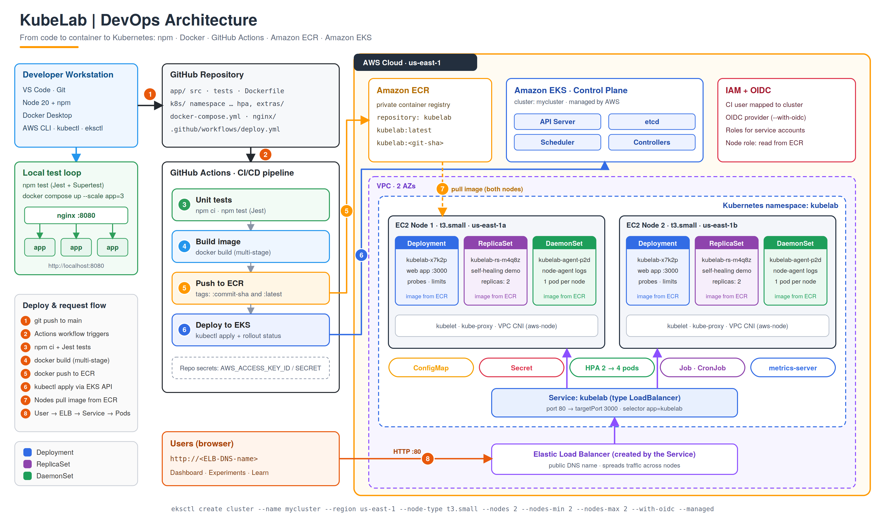

# KubeLab: learn Docker, ECR, EKS and Kubernetes by doing

A working Node.js app plus every file you need to containerize it, push it to **Amazon ECR**, and run it on **Amazon EKS** with a **ReplicaSet, Deployment, DaemonSet, Service, ConfigMap, Secret, Job, CronJob and HPA**. The web UI shows which pod answers, lets you crash a pod, and burns CPU to trigger autoscaling, so each concept is visible.

## 1. Architecture



Editable vector version: `docs/architecture.svg`. Steps 1-8 follow a change from `git push` to a user request.

## 2. Where every file goes

```
kubelab/
├── app/
│   ├── src/app.js, server.js        <- API (health, info, tasks, load, crash)
│   ├── src/agent.js                 <- DaemonSet workload
│   ├── src/job.js                   <- Job / CronJob workload
│   ├── public/index.html            <- UI (Dashboard, Experiments, Learn, Checklist)
│   ├── tests/app.test.js            <- Jest + Supertest
│   ├── Dockerfile                   <- DOCKERFILE (multi-stage: test / runtime)
│   ├── .dockerignore
│   ├── package.json
│   └── package-lock.json            <- created by npm install; MUST be committed (CI uses npm ci)
├── docker-compose.yml               <- DOCKER COMPOSE (project root): app x3 + nginx + test
├── nginx/nginx.conf                 <- load balancer config for Compose
├── k8s/                             <- KUBERNETES YAML (apply order = file number)
│   ├── 00-namespace.yaml  01-configmap.yaml  02-secret.yaml
│   ├── 03-deployment.yaml 04-service.yaml
│   └── extras/ replicaset.yaml daemonset.yaml job.yaml cronjob.yaml hpa.yaml
├── scripts/ create-cluster.sh  deploy.sh  cleanup.sh
├── .github/workflows/deploy.yml     <- GitHub Actions (path must be exact)
├── docs/architecture.png / .svg     <- architecture diagram
├── docs/screenshots/                <- save your screenshots here (names in the Word report)
├── Makefile                         <- shortcuts: make test / up / cluster / deploy / cleanup
└── README.md
```
Image lines in the YAML say `ACCOUNT_ID.dkr.ecr...`. Leave them: `deploy.sh` and the pipeline replace it with your real account ID.

## 3. Prerequisites
Node 20+, Docker, Git, AWS CLI (`aws configure`), `eksctl`, `kubectl`. Optional: GitHub CLI (`gh`).

Check your AWS login works before starting:
```bash
aws sts get-caller-identity       # shows your Account ID and user ARN
```

## 4. Module 1: run with npm and test
```bash
cd app && npm install && npm test && npm start     # http://localhost:3000
```
Learn: 8 tests cover health, pod metadata, secret never leaking, CRUD, validation, crash and load endpoints.
`npm install` creates `app/package-lock.json`. Keep it: the Dockerfile and GitHub Actions both use `npm ci`, which fails without it.

## 5. Module 2: Docker and Compose
```bash
# inside app/ (Dockerfile is here)
docker build -t kubelab:local . && docker run -d -p 3000:3000 kubelab:local
cd ..                                            # Compose files are in the project ROOT
docker compose up --build --scale app=3         # http://localhost:8080 (nginx -> 3 containers)
docker compose ps && docker compose logs -f app
docker compose --profile test run --rm test     # tests inside a container
docker compose down
```
Stop the plain container from the first command when finished: `docker ps`, then `docker stop <container id>`.
Learn: images vs containers, multi-stage builds, health checks, a reverse proxy balancing 3 replicas. In the UI open **Experiments > Send 20 requests**: bars show the 3 containers.

## 6. Module 3: create the EKS cluster (free-tier sizing)
```bash
eksctl create cluster --name mycluster --region us-east-1 --node-type t3.small  --nodes 2 --nodes-min 2 --nodes-max 2 --with-oidc --managed     # 2 Ready (20-25 min)
aws eks update-kubeconfig --name mycluster --region us-east-1
kubectl get nodes -o wide
```

## 7. Module 4: ECR + deploy everything

### 7.1 Understand ECR
Amazon ECR is AWS's private Docker registry. EKS nodes pull your image from it. The flow is always: **create repository, log in, build, tag, push, verify**.

### 7.2 Set variables (run once per terminal)
```bash
export AWS_REGION=us-east-1
export ACCOUNT_ID=$(aws sts get-caller-identity --query Account --output text)
export ECR_REPO=kubelab
export REGISTRY=$ACCOUNT_ID.dkr.ecr.$AWS_REGION.amazonaws.com
export ECR_URI=$REGISTRY/$ECR_REPO
echo $ECR_URI                      # e.g. 123456789012.dkr.ecr.us-east-1.amazonaws.com/kubelab
```

### 7.3 Create the repository
```bash
aws ecr create-repository --repository-name $ECR_REPO --region $AWS_REGION \
  --image-scanning-configuration scanOnPush=true
```
Console alternative: AWS Console > **ECR** > Private registry > Repositories > **Create repository** > name `kubelab`.
The name must be exactly `kubelab`, because the YAML files and the GitHub Actions workflow use it.

### 7.4 Log in, build, tag and push
Run these from the project root (the folder that contains `app/`, `k8s/`, `scripts/`):
```bash
# 1) Log Docker in to ECR (token lasts 12 hours)
aws ecr get-login-password --region $AWS_REGION | docker login --username AWS --password-stdin $REGISTRY

# 2) Build the runtime image
docker build -t kubelab:latest ./app

# 3) Tag it with the ECR address (latest + a version tag)
docker tag kubelab:latest $ECR_URI:latest
docker tag kubelab:latest $ECR_URI:v2.0.0

# 4) Push both tags
docker push $ECR_URI:latest
docker push $ECR_URI:v2.0.0
```

### 7.5 Verify the image is in ECR
```bash
aws ecr list-images --repository-name $ECR_REPO --region $AWS_REGION
aws ecr describe-images --repository-name $ECR_REPO --region $AWS_REGION \
  --query 'imageDetails[].{tags:imageTags,pushed:imagePushedAt,sizeBytes:imageSizeInBytes}' --output table
```
Console: ECR > Repositories > `kubelab` > you should see `latest` and `v2.0.0`. Take a screenshot for the report (Figure: ECR repository).

### 7.6 Deploy to the cluster
```bash
cd ..
cd ./k8s
kubectl apply -f .\03-deployment.yaml                                                                    
kubectl apply -f .\00-namespace.yaml                                                                     
kubectl apply -f .\01-configmap.yaml                                                                     
kubectl apply -f .\02-secret.yaml                                                                        
kubectl apply -f .\03-deployment.yaml                                                                    
kubectl apply -f .\04-service.yaml                                                                       
kubectl -n kubelab get all                                                                               
kubectl -n kubelab get svc kubelab     # open EXTERNAL-IP in the browser
```
`deploy.sh` repeats steps 7.3 to 7.4 automatically (it creates the repository only if it is missing), installs metrics-server, and applies every YAML file. Running it after the manual steps is safe.

### 7.7 Checking
```bash
kubectl cluster-info
kubectl get nodes
kubectl get pods -n kubelab
kubectl get svc -n kubelab
kubectl get deployments -n kubelab
kubectl get ns
```


## 8. Module 5: Kubernetes experiments (the learning part)
**Pods and Deployment**
```bash
kubectl -n kubelab get pods -o wide
kubectl -n kubelab describe deploy kubelab
kubectl -n kubelab scale deploy kubelab --replicas=3        # (HPA may override; see the HPA experiment below)
```
**ReplicaSet self-healing** (break it on purpose)
```bash
kubectl apply -f .\replicaset.yaml
kubectl get replicasets -n kubelab
kubectl get rs -n kubelab
kubectl get pods -n kubelab
kubectl delete pod <pod-name> -n kubelab
kubectl scale rs kubelab-rs -n kubelab --replicas=4
kubectl get rs,pods -n kubelab
```
**DaemonSet** (one pod per node)
```bash
kubectl apply -f .\daemonset.yaml
kubectl -n kubelab get ds
kubectl -n kubelab get pods -l app=kubelab-agent -o wide    # 2 pods on 2 different nodes
kubectl -n kubelab logs ds/kubelab-agent
```
**Rolling update and rollback**
```bash
kubectl -n kubelab set env deploy/kubelab APP_VERSION=2.1.0
kubectl -n kubelab rollout status deploy/kubelab
kubectl -n kubelab rollout history deploy/kubelab
kubectl -n kubelab rollout undo deploy/kubelab
```
**ConfigMap and Secret**
```bash
kubectl -n kubelab edit configmap kubelab-config            # change WELCOME_MESSAGE
kubectl -n kubelab rollout restart deploy/kubelab           # env vars load on pod start
kubectl -n kubelab get secret kubelab-secret -o yaml        # base64 is encoding, NOT encryption
```
**Self-healing by crashing** : UI > Experiments > *Crash the pod*, then `kubectl -n kubelab get pods` (RESTARTS increases).
**Load balancing** : UI > Experiments > *Send 20 requests*: different pods answer.
**Job and CronJob**
```bash
kubectl apply -f .\cronjob.yaml   
kubectl apply -f .\job.yaml                                                              
kubectl -n kubelab get jobs,cronjobs
kubectl -n kubelab logs job/kubelab-job
```
**HPA (autoscaling)**: run `kubectl -n kubelab get hpa -w` in one terminal; in the UI click *Burn CPU*. Replicas rise toward 4, then fall after a few minutes. Check `kubectl top pods -n kubelab`.
**Troubleshooting toolkit**: `describe`, `logs`, `logs --previous`, `get events --sort-by=.lastTimestamp`, `exec -it <pod> -- sh`, `port-forward svc/kubelab 8081:80`.

## 9. Before Module 6: CI/CD prerequisites (one-time setup)
GitHub Actions does not create anything for you. It needs a running cluster, an existing ECR repository, an AWS identity that is allowed into the cluster, and secrets in GitHub. Do these steps in order.

### 9.1 Checklist: what must already exist
| Needed | How to check | Created in |
|---|---|---|
| EKS cluster `mycluster` in `us-east-1`, 2 nodes Ready | `kubectl get nodes` | Module 3 |
| ECR repository `kubelab` | `aws ecr describe-repositories --repository-names kubelab --region us-east-1` | Module 4 (7.3) |
| App deployed once (namespace `kubelab` exists) | `kubectl get ns kubelab` | Module 4 (7.6) |
| `app/package-lock.json` exists | `ls app/package-lock.json` | Module 1 |

### 9.2 Create a dedicated IAM user for GitHub Actions
Do not put your personal admin keys in GitHub. Create a CI user with only what the pipeline needs: push to ECR and describe the cluster.
```bash
export CI_USER=github-actions-kubelab
aws iam create-user --user-name $CI_USER

# Push/pull images in ECR
aws iam attach-user-policy --user-name $CI_USER \
  --policy-arn arn:aws:iam::aws:policy/AmazonEC2ContainerRegistryPowerUser

# Needed by "aws eks update-kubeconfig" in the pipeline
cat > /tmp/eks-describe.json <<'POLICY'
{ "Version": "2012-10-17",
  "Statement": [{ "Effect": "Allow", "Action": ["eks:DescribeCluster"], "Resource": "*" }] }
POLICY
aws iam put-user-policy --user-name $CI_USER --policy-name EksDescribeCluster \
  --policy-document file:///tmp/eks-describe.json

# Create the access key. The secret is shown ONLY ONCE: copy it now.
aws iam create-access-key --user-name $CI_USER
```
Copy `AccessKeyId` and `SecretAccessKey` from the output. Never commit them to Git.
Console alternative: IAM > Users > Create user > attach the policy above > Security credentials > Create access key > "Application running outside AWS".

### 9.3 Give that user access inside the cluster
AWS permissions get the pipeline to the cluster, but Kubernetes must also accept the user. Map it (learning setup uses `system:masters`, which is full admin; use something narrower in real projects):
```bash
export ACCOUNT_ID=$(aws sts get-caller-identity --query Account --output text)

eksctl create iamidentitymapping --cluster mycluster --region us-east-1 \
  --arn arn:aws:iam::$ACCOUNT_ID:user/$CI_USER \
  --group system:masters --username github-actions

eksctl get iamidentitymapping --cluster mycluster --region us-east-1     # your CI user should be listed
```
If you delete and recreate the cluster later, repeat this step.

### 9.4 Test the CI credentials locally (before touching GitHub)
This catches 90% of pipeline failures in a minute.
```bash
aws configure --profile github-ci          # paste the CI key + secret, region us-east-1, output json

AWS_PROFILE=github-ci aws sts get-caller-identity                         # ARN must end with user/github-actions-kubelab
AWS_PROFILE=github-ci aws ecr describe-repositories --region us-east-1    # lists kubelab
AWS_PROFILE=github-ci aws eks update-kubeconfig --name mycluster --region us-east-1 --kubeconfig /tmp/ci-kubeconfig
KUBECONFIG=/tmp/ci-kubeconfig kubectl -n kubelab get pods                 # must list pods, not "Unauthorized"
```
If the last command says `You must be logged in to the server (Unauthorized)`, redo 9.3.

### 9.5 Create the GitHub repository and push the code
Suggested repo name: `kubelab-eks-devops`.
```bash
git init
git branch -M main                           # the workflow deploys only from main
git add .
git commit -m "feat: KubeLab - Docker, ECR, EKS, Kubernetes learning project with CI/CD"

# Option A: GitHub CLI (creates the repo and pushes)
gh repo create kubelab-eks-devops --public --source=. --remote=origin --push

# Option B: create an empty repo on github.com (no README, no .gitignore), then:
git remote add origin https://github.com/<your-username>/kubelab-eks-devops.git
git push -u origin main
```
Check that the lock file was committed: `git ls-files app/package-lock.json` must print the path.
Note: this first push already starts the workflow. If it fails with a missing-secret error, that is expected: add the secrets next and re-run it.

### 9.6 Add the GitHub secrets
```bash
gh secret set AWS_ACCESS_KEY_ID           # paste the AccessKeyId
gh secret set AWS_SECRET_ACCESS_KEY       # paste the SecretAccessKey
gh secret list
```
Browser alternative: repo > **Settings** > Secrets and variables > **Actions** > New repository secret. The names must match exactly. Region, cluster name and repository name are already set in `.github/workflows/deploy.yml` (`us-east-1`, `mycluster`, `kubelab`); change them there only if you used different names.

## 10. Module 6: GitHub Actions CI/CD
1. Open the repo > **Actions** tab. If the first run failed (secrets were missing), open it and click **Re-run all jobs**.
2. The workflow has two jobs: **test** (`npm ci`, `npm test`) and **deploy** (login to ECR, build, push, `kubectl apply`, rollout). Pull requests run only the test job; pushes to `main` run both.
3. Trigger a real deployment by changing something visible:
   ```bash
   # edit k8s/01-configmap.yaml: change WELCOME_MESSAGE to "Deployed by GitHub Actions"
   git add . && git commit -m "feat: change welcome message" && git push
   ```
4. Watch the run go green, then verify:
   ```bash
   kubectl -n kubelab rollout status deploy/kubelab
   kubectl -n kubelab get deploy kubelab -o jsonpath='{.spec.template.spec.containers[0].image}'; echo   # ends with a commit SHA
   kubectl -n kubelab rollout history deploy/kubelab
   aws ecr list-images --repository-name kubelab --region us-east-1      # new tag = commit SHA
   ```
   Refresh the UI: the ConfigMap message card shows the new text. Take screenshots of the green run and the ECR tags for the report.

## 11. Clean up (do not skip)
```bash
./scripts/cleanup.sh
```
Then remove the CI user so no access key is left behind:
```bash
export CI_USER=github-actions-kubelab
KEY_ID=$(aws iam list-access-keys --user-name $CI_USER --query 'AccessKeyMetadata[0].AccessKeyId' --output text)
aws iam delete-access-key --user-name $CI_USER --access-key-id $KEY_ID
aws iam detach-user-policy --user-name $CI_USER --policy-arn arn:aws:iam::aws:policy/AmazonEC2ContainerRegistryPowerUser
aws iam delete-user-policy --user-name $CI_USER --policy-name EksDescribeCluster
aws iam delete-user --user-name $CI_USER
```
Also delete the two secrets in GitHub (Settings > Secrets). Check the AWS console: no EKS cluster, EC2 nodes, load balancer, or CloudFormation stacks left. EKS is not free-tier.
After cleanup the pipeline's deploy job will fail until you repeat Module 3, 4 and section 9.

## 12. Troubleshooting
| Symptom | Cause / fix |
|---|---|
| `ImagePullBackOff` | ECR image missing: re-run `deploy.sh`; `kubectl -n kubelab describe pod <pod>` |
| `Pending` pods, "Too many pods" | t3.small allows ~11 pods per node; delete the ReplicaSet (`kubectl -n kubelab delete rs kubelab-rs`) or lower replicas |
| EXTERNAL-IP `<pending>` | wait 2-3 min; `describe svc kubelab` |
| HPA shows `<unknown>` | metrics-server not ready: `kubectl get deploy metrics-server -n kube-system` |
| Compose: nginx 502 after scaling | `docker compose restart nginx` (it caches container IPs) |
| `docker push`: `no basic auth credentials` | Login expired: repeat the `aws ecr get-login-password ... docker login` command |
| `docker push`: `repository does not exist` | Create it (7.3); the name must be `kubelab` and the region must match |
| Actions: `Credentials could not be loaded` | Secret names wrong or missing (9.6) |
| Actions: `RepositoryNotFoundException` | ECR repo `kubelab` not created in `us-east-1` (7.3) |
| Actions: `AccessDenied ... eks:DescribeCluster` | Add the inline policy from 9.2 |
| Actions: `You must be logged in to the server (Unauthorized)` | IAM identity mapping missing (9.3); recheck with `eksctl get iamidentitymapping` |
| Actions: `npm ci` error / no lock file | `app/package-lock.json` not committed (`git add app/package-lock.json`) |
| Actions: deploy job never runs | You pushed to a branch other than `main`, or it is a pull request |

## 13. Report
Open `KubeLab-Project-Report.docx`; each box says which screenshot to paste and the file name to save in `docs/screenshots/`.

## 14. Ideas to go further
Ingress + AWS Load Balancer Controller, HTTPS with ACM, StatefulSet with EBS, Helm, Terraform, Prometheus and Grafana, GitHub OIDC (keyless auth) instead of access keys.